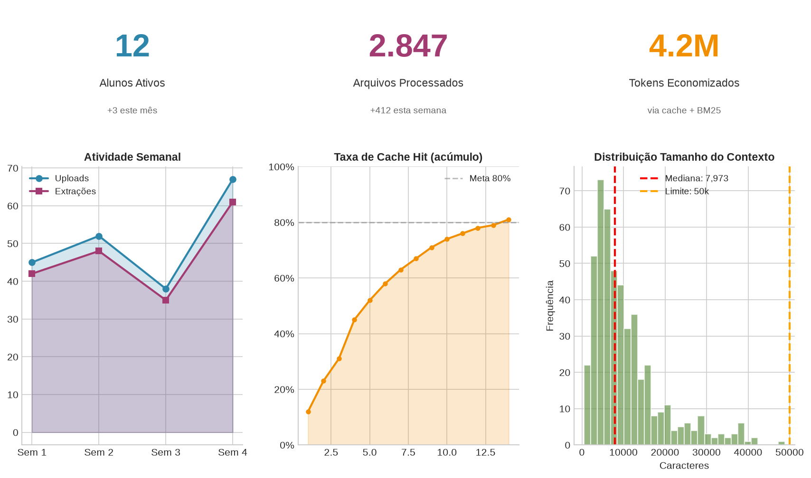
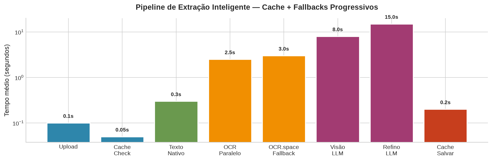
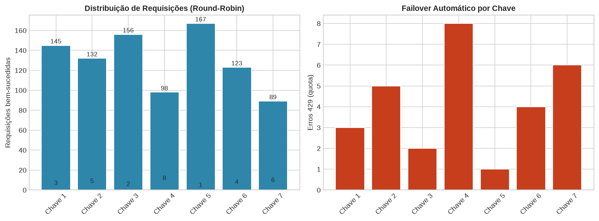
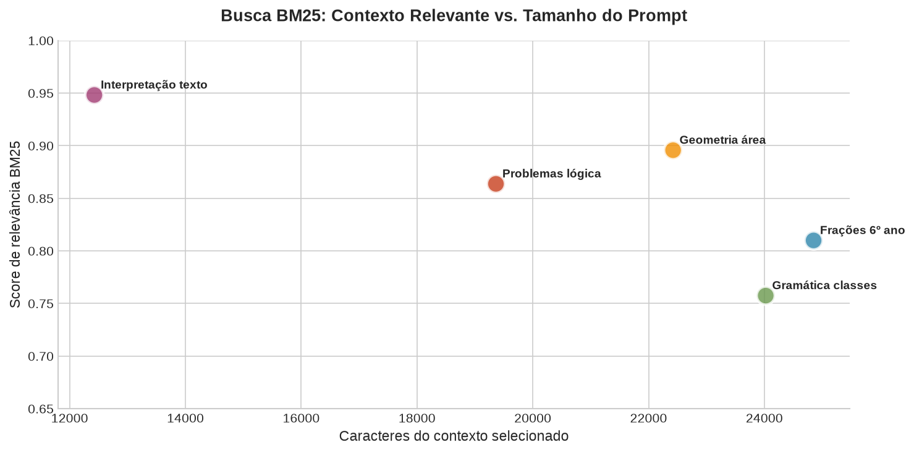
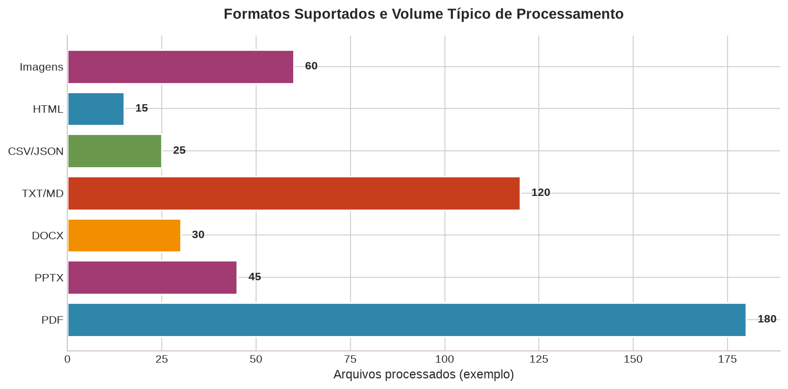
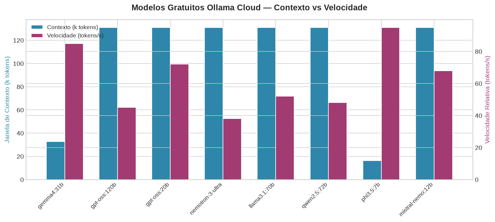
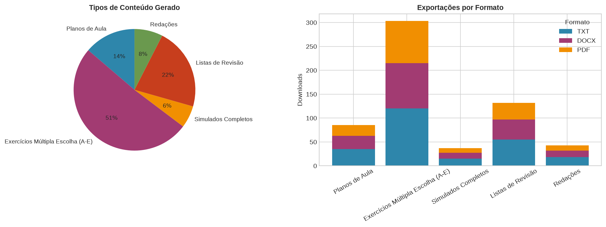

# Edu Assistant

Ferramenta para professores particulares: gerencie documentos por aluno, extraia texto rápido com cache, converse com o contexto via busca BM25 e gere planos de aula e exercícios personalizados com modelos LLM (Ollama Cloud).

## Funcionalidades

- **Separação por aluno**: cada aluno tem sua pasta em `docs/<aluno>/`, com uploads, contexto, chat e estatísticas isolados
- **Extração rápida multi-formato**: PDF (PyMuPDF em memória, OCR Tesseract paralelo), PPTX, DOCX, TXT, MD, JSON, CSV, HTML, PNG, JPG
- **Cache por arquivo**: `docs/<aluno>/.cache/<hash>.txt` — reabrir o app é instantâneo
- **Rotação de chaves Ollama**: round-robin entre as chaves em `OLLAMA_API_KEYS` com failover automático em 429/cota
- **RAG com BM25**: a cada pergunta, monta só o contexto relevante dentro do limite de caracteres
- **Planos de aula e exercícios**: exercícios no padrão Colégio Militar com **5 alternativas (A–E)** e gabarito
- **Downloads** em TXT, DOCX ou PDF
- **Provedor NVIDIA** como alternativa ao Ollama (NVIDIA NIM, endpoints gratuitos)

## Estrutura

```
edu-assistant/
├── app.py                 # entrada Streamlit (fina)
├── core/                  # config, ollama_client (rotação), generators, exporters, retrieval (BM25)
├── extractors/            # pdf, office, plain, image, cache, clean
├── ui/                    # sidebar, documents, chat, tools
├── docs/                  # pasta local dos alunos (não versionada)
├── scripts/
│   └── fetch_student_sources.py
├── .env / .env.example
├── docker-compose.yml
└── pyproject.toml
```

> A pasta `docs/` é criada automaticamente na primeira execução e fica fora do controle de versão — cada usuário usa seus próprios materiais.

## Como usar com Docker

1. Clone o repositório e entre na pasta:
   ```bash
   git clone <repo-url>.git
   cd edu-assistant
   ```
2. Copie e edite o arquivo de ambiente:
   ```bash
   cp .env.example .env
   ```
   Preencha `OLLAMA_API_KEYS` (várias chaves separadas por vírgula) e, opcionalmente, `OCR_SPACE_API_KEY`.
3. Suba o serviço:
   ```bash
   docker-compose up -d
   ```
4. Acesse `http://localhost:8501`.
5. Pare os serviços:
   ```bash
   docker-compose down
   ```

## Como usar sem Docker (desenvolvimento local)

1. Instale o Python 3.10+ e o `uv`:
   ```bash
   pip install uv
   ```
2. Instale as dependências:
   ```bash
   uv sync
   ```
3. Configure o `.env` (veja `.env.example`). Requisitos locais: Tesseract OCR (com idioma `por`) e, opcionalmente, Pandoc + LaTeX para exportação PDF/DOCX fiel.
4. Execute:
   ```bash
   uv run streamlit run app.py
   ```
5. Acesse `http://localhost:8501`.

## Baixar materiais de provas (opcional)

Baixe provas de fontes oficiais (Colégios Militares, UERJ, ENEM) para o aluno desejado:

```bash
uv run python scripts/fetch_student_sources.py
```

Os PDFs são salvos em `docs/<aluno>/provas/<fonte>/`.

## Variáveis de ambiente

| Variável | Descrição | Exemplo |
|----------|-----------|---------|
| `OLLAMA_HOST` | URL da API Ollama | `https://ollama.com` |
| `OLLAMA_API_KEYS` | Chaves em rotação, separadas por vírgula | `chave1,chave2,chave3` |
| `OLLAMA_AVAILABLE_MODELS` | Modelos gratuitos cloud | `gemma4:31b,gpt-oss:120b` |
| `OLLAMA_VISION_MODELS` | Modelos com visão (fallback de OCR) | `gemma4:31b` |
| `OLLAMA_MAX_TOKENS` | Máximo de tokens gerados | `8192` |
| `NVIDIA_API_KEYS` | Chaves NVIDIA NIM (opcional), separadas por vírgula | `nvapi-...` |
| `MAX_CONTEXT_CHARS` | Limite de caracteres do prompt | `50000` |
| `OCR_SPACE_API_KEY` | Chave OCR.space (fallback de PDF escaneado) | `K...` |
| `EXTRACTION_CACHE` | Cache de extração (`1`/`0`) | `1` |
| `LLM_REFINE` | Refino de OCR via LLM por padrão (`1`/`0`) | `0` |
| `OCR_WORKERS` | Workers paralelos de OCR | `4` |

Para usar a NVIDIA, crie uma chave gratuita em https://build.nvidia.com, defina `NVIDIA_API_KEYS` e selecione o provedor "nvidia" no app.

## Tecnologias

- Streamlit (interface)
- PyMuPDF + Tesseract (extração/OCR)
- Ollama Cloud / NVIDIA NIM (LLM, com rotação de chaves)
- BM25 próprio (busca de contexto, sem dependências extras)
- python-docx, reportlab, pandoc (exportação)
- Docker (containerização)

## Privacidade

Este projeto lida com materiais de alunos (menores de idade). Por isso:

- A pasta `docs/` **não é versionada** — os dados ficam apenas na máquina de quem usa.
- O `.env` (com chaves de API) **não é versionado** — use `.env.example` como modelo.
- Antes de publicar um fork, revise o histórico do Git para garantir que nenhum material de aluno foi commitado.

---

## Visualizações e Métricas (Data Science View)

### Dashboard Resumo


### Pipeline de Extração Inteligente
Extração em cascata com cache + fallbacks progressivos (OCR local → OCR.space → Visão LLM).


### Rotação de Chaves e Failover Automático
Distribuição round-robin entre 7 chaves Ollama com detecção automática de quota (429) e failover.


### Busca BM25: Contexto Relevante
Score de relevância vs. tamanho do contexto selecionado para diferentes tipos de consulta pedagógica.


### Formatos Suportados
Volume típico de processamento por formato de arquivo.


### Modelos Gratuitos Ollama Cloud
Comparativo de janela de contexto e velocidade relativa entre modelos gratuitos disponíveis.


### Tipos de Saída e Exportação
Conteúdo gerado (planos, exercícios, simulados) e formatos de download (TXT, DOCX, PDF).


---

*Gráficos gerados com `scripts/generate_readme_charts.py` usando dados sintéticos representativos — nenhum dado real de aluno.*
